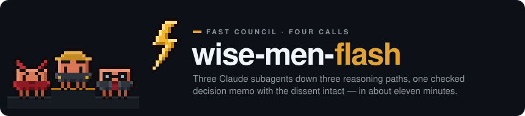

<p align="center"></p>

[](https://github.com/Ali-expandings/wise-men-flash/stargazers) [](LICENSE) [](https://github.com/Ali-expandings/wise-men-flash/actions/workflows/check.yml) [](#install)

A decision helper for [Claude Code](https://claude.com/claude-code). You ask a hard question, three agents answer it separately (one of them argues against the obvious answer on purpose), and you get back one short memo: what to do, why, the first step, the risks, and the best case against it.

It is the fast version of [wise-men](https://github.com/Ali-expandings/wise-men). About 15 minutes a question instead of 50.

## Try it in two minutes

```
/plugin marketplace add Ali-expandings/wise-men-flash
/plugin install wise-men-flash@wise-men-flash
```

Restart Claude Code, then ask:

```
/wise-men-flash should we move everyone to annual billing to cut churn?
```

## What comes back

A memo with six parts: **Recommendation, Why, What to do, Risks, Strongest counter-position, Confidence.** No "the panel agreed", no scores.

Real example, shortened. Question: *"My boss offered to sell me the landscaping business I've worked at for eight years. Should I say yes?"*

> **Recommendation:** pursue it, but don't sign yet. Run the books and the bidding under him for a season, have an outside accountant check the real earnings, and write your walk-away conditions down before you see the final numbers.
>
> **Strongest counter-position:** don't pay for the client goodwill at all. Much of it is your own eight years, sold back to you.

[Full memo](eval-data/consistency-check/answers/R508-new.md)

## Does it work?

In a blind test on eight new questions, judged by three Claude Opus judges that didn't know which answer came from which tool, it scored 23.4/25. The full wise-men council scored 23.6 and took three times as long (16.7 vs 50.2 minutes). Seven other council skills scored 14.9 to 19.1. Every judge and every answer was a Claude model, with no human grading, so read it as a strong signal, not proof.

Charts, method, caveats and how it works: [DETAILS.md](DETAILS.md).

## When not to use it

Lookups, quick facts, or anything you can undo in a minute: just ask Claude. For big, hard-to-undo decisions, use the full [wise-men](https://github.com/Ali-expandings/wise-men).

## Install

**Plugin (recommended):**

```
/plugin marketplace add Ali-expandings/wise-men-flash
/plugin install wise-men-flash@wise-men-flash
```

**Or clone into your skills folder:**

```bash
git clone https://github.com/Ali-expandings/wise-men-flash.git ~/.claude/skills/wise-men-flash
mkdir -p ~/.claude/agents && [ -f ~/.claude/agents/wise-member.md ] || cp ~/.claude/skills/wise-men-flash/agents/wise-member.md ~/.claude/agents/
```

**Or with [skills.sh](https://skills.sh):**

```bash
npx skills add Ali-expandings/wise-men-flash -g
mkdir -p ~/.claude/agents && [ -f ~/.claude/agents/wise-member.md ] || cp ~/.claude/skills/wise-men-flash/agents/wise-member.md ~/.claude/agents/
```

The second line installs `wise-member`, a read-only agent (Read, Grep, Glob) so the council can't run commands or edit your files. No API keys, no external services.

Options: `--strong` puts every member on the strong model, `--cheap` runs a lighter council and says so in the answer.

## Repo layout

```
.claude-plugin/        plugin + marketplace manifests
SKILL.md               the whole protocol, self-contained (the only file Claude Code loads)
agents/wise-member.md  tool-restricted member agent — registered by the plugin install
examples/              two real round-4 answers, verbatim, with the judges' scores
eval-data/             rounds 4 and 5: raw answers, blinded packets, judgments, parsed scores,
                       flash4.py, h2h5.py, RESULTS.md, RESULTS-V5.md; PREREG-1 (superseded)
scripts/check.sh       consistency and reproduction checks — run before every commit
scripts/make_charts.py regenerates assets/*.svg (light + dark) from the data
assets/                banner + charts (hand-authored SVG)
CHANGELOG.md · AGENTS.md · CONTRIBUTING.md · SECURITY.md · requirements.txt · LICENSE
```

The skill itself has **no runtime dependencies** — it is markdown that Claude Code reads. Python and PyYAML are needed only to re-run the analysis and the charts.

## Credits

The fast tier of [wise-men](https://github.com/Ali-expandings/wise-men), extracted into its own skill. Inspired by [karpathy/llm-council](https://github.com/karpathy/llm-council). Design choices drew on — but are **not validated by** — Du et al. 2023 (multi-agent debate), Liang et al. 2024 (divergent thinking), Khan et al. 2024 (debate via persuasion), Zheng et al. 2024 (LLM-as-judge bias).

## License

MIT — see [LICENSE](LICENSE).
